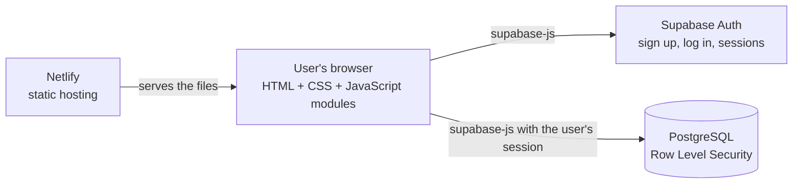
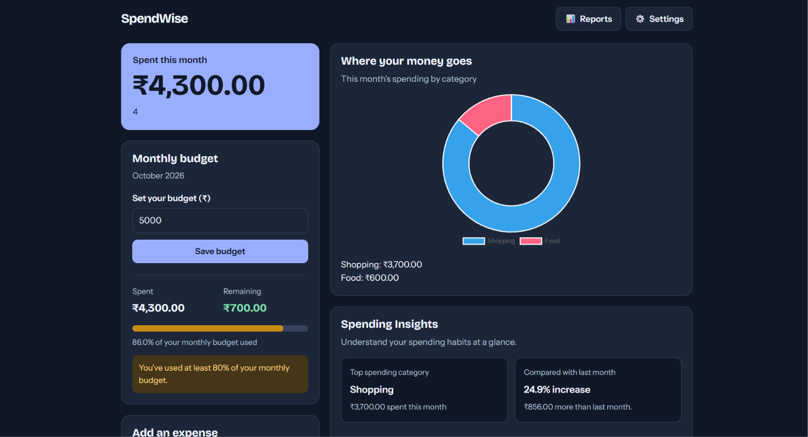
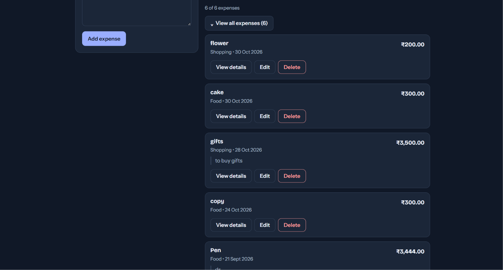
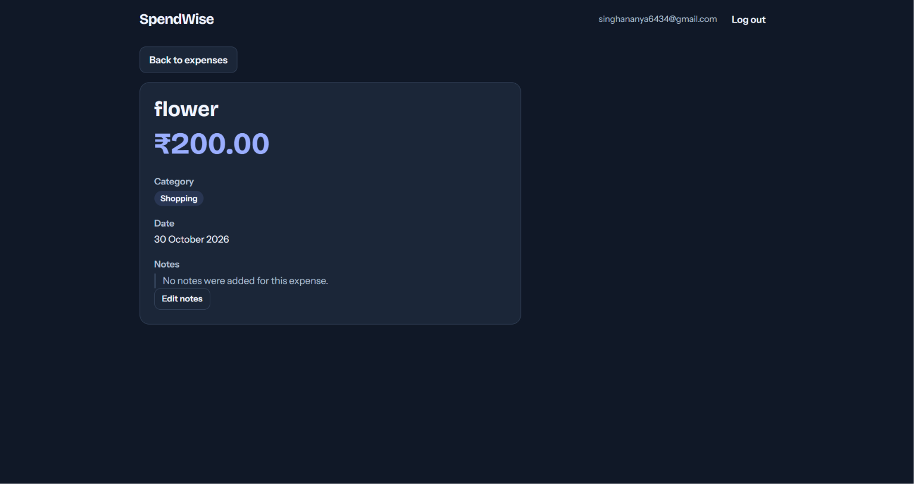
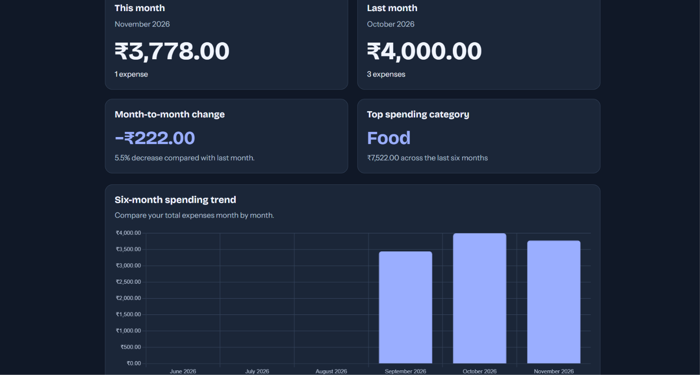
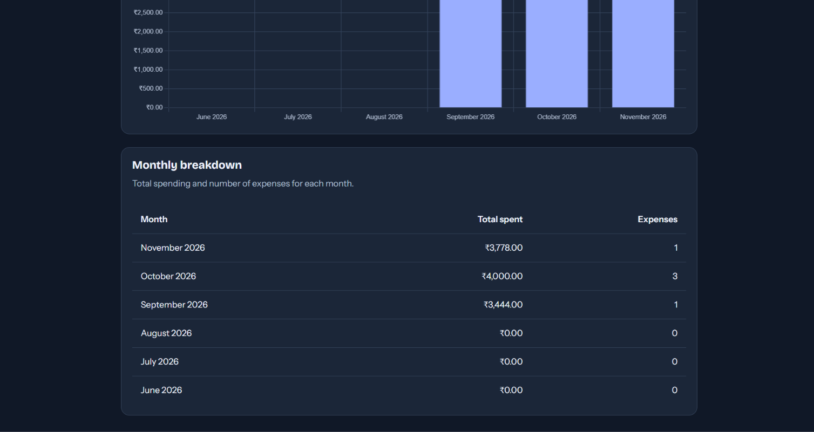
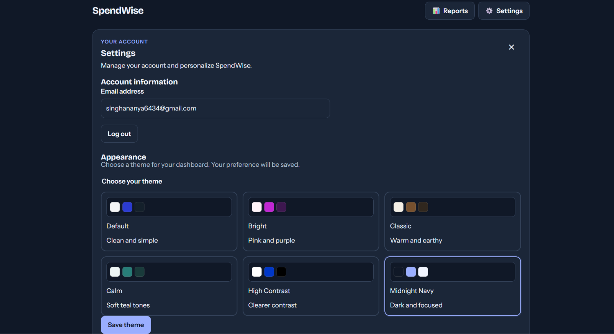

# SpendWise

**A personal expense tracker with budgets, reports and themes, built with HTML, CSS, JavaScript and Supabase.**

[**Live demo**](https://spendwise-ananya-81348.netlify.app/) · [GitHub repository](https://github.com/Ananya9682/SpendWise)

SpendWise helps people record what they spend, see where their money goes, and stay within a monthly budget. Each user signs up with an email address and sees only their own data. The app runs entirely in the browser and uses Supabase for login and storage, so there is no custom server to maintain.

---

## Table of contents

1. [Problem statement and purpose](#problem-statement-and-purpose)
2. [Key features](#key-features)
3. [Technologies used](#technologies-used)
4. [How it works](#how-it-works)
5. [Screenshots](#screenshots)
6. [Installation and local setup](#installation-and-local-setup)
7. [Supabase configuration](#supabase-configuration)
8. [Deployment](#deployment)
9. [Project structure](#project-structure)
10. [Security notes](#security-notes)
11. [Known limitations](#known-limitations)
12. [Future improvements](#future-improvements)
13. [Development approach](#development-approach)
14. [Author](#author)

---

## Problem statement and purpose

Many students and young adults do not track their spending. Small purchases add up, and by the end of the month it is hard to say where the money went. Notes apps and spreadsheets work, but they are easy to forget and give no feedback.

SpendWise is a simple web app that makes tracking quick and gives feedback straight away: a running monthly total, a spending breakdown by category, a budget progress bar with warnings, and a six-month report. It was built as a learning project to practise full-stack fundamentals: authentication, a relational database, per-user data security, data visualisation and responsive, accessible design.

---

## Key features

Every feature below exists in the code in this repository.

### Accounts and security
- Email and password **sign-up, login and logout** using Supabase Auth.
- Protected pages: visitors who are not logged in are redirected to the login page.
- **Per-user data isolation** using PostgreSQL Row Level Security (the database policies are in [Supabase configuration](#supabase-configuration)).

### Expense management
- **Add, edit and delete** expenses with a title, amount, category, date and notes.
- Eight categories: Food, Transport, Education, Rent and bills, Shopping, Health, Entertainment and Other.
- A **notes** field to record what an expense was for and why.
- A separate **expense details page** for each expense, with a button back to the list.
- A **collapsible list** that shows the five newest matching expenses, with a "View all expenses (N)" button to expand and "Show less" to collapse.

### Search, filters and export
- **Search** by title, category or notes.
- Filter by **category** and by **date range**, with a **Clear filters** button and a live "X of Y expenses" count.
- **Export all expenses to CSV** (Title, Amount, Category, Date, Notes). The export neutralises text that could be run as a formula when opened in a spreadsheet.

### Budgets and insights
- Set a **monthly budget** and see a progress bar and the amount remaining or over budget.
- **Budget alerts:** a warning at 80% of the budget and an over-budget alert at 100%.
- A dashboard summary of **this month's total** and a **spending-by-category chart**.
- **Spending Insights:** top spending category this month and a month-to-month comparison (percentage increase or decrease).

### Reports page
- Current month vs last month totals and the change between them.
- Top spending category over the last six months.
- A **six-month spending bar chart** and a **monthly breakdown table** (total spent and number of expenses per month).

### Settings and themes
- A Settings panel showing the account email, a **theme picker** and the **Log out** button.
- **Six themes:** Default, Youthful, Classic, Calm, High Contrast and Midnight Navy.
- The chosen theme is **saved to the user's account** and applied on both the dashboard and the Reports page, with a browser fallback if the saved theme cannot be loaded.

### Design and accessibility
- **Responsive layout** for laptops and phones.
- Skip-to-content links, labelled form fields, status messages that screen readers announce, visible keyboard focus, a High Contrast theme, and support for the "reduce motion" setting.
- Amounts display in Indian rupees (INR). The currency code is a single setting in `js/config.js`.

---

## Technologies used

| Technology | Role in this project |
|---|---|
| **HTML5** | Structure of every page |
| **CSS3** | Layout, responsive design and the six themes (using CSS custom properties) |
| **JavaScript (ES modules)** | All application logic, written in plain JavaScript with no framework or build step |
| **[Supabase](https://supabase.com/)** | Back end: Auth (accounts and sessions) and PostgreSQL (data), protected by Row Level Security |
| **[supabase-js](https://github.com/supabase/supabase-js) v2.49.4** | Official client library, loaded from the jsDelivr CDN |
| **[Chart.js](https://www.chartjs.org/)** | Spending-by-category chart and the six-month bar chart (loaded from the jsDelivr CDN) |
| **Google Fonts** | Bricolage Grotesque (headings) and Instrument Sans (body text) |
| **Git and GitHub** | Version control and source hosting |
| **Netlify** | Static hosting for the live site |
| **VS Code + Live Server** | Local development |

There is no `package.json`, bundler or server code. The site is static files plus Supabase.

---

## How it works



1. **Pages and scripts.** Each page loads one JavaScript module. Shared modules handle the Supabase connection (`supabaseClient.js`), session checks and logout (`auth.js`) and the saved theme for the Reports page (`theme.js`).
2. **Authentication.** After login, Supabase keeps the session in the browser and sends it with every request. Protected pages check for a session and redirect to the login page if there is none.
3. **Data access.** The app reads and writes three tables through the Supabase client: `expenses`, `budgets` and `user_preferences`.
4. **Privacy.** The database enforces a rule on every table: a user can only read or change rows where `user_id` matches their own account. This protection lives in the database, not only in the page code.
5. **Rendering.** The scripts calculate totals, budget progress, filters and insights in the browser, then draw the results. User-entered text is inserted as plain text, never as HTML.
6. **Themes.** Each theme is a set of CSS variables selected by a `data-theme` attribute. The saved theme is stored per user in `user_preferences`.

### Data model

| Table | Purpose | Columns used by the app |
|---|---|---|
| `expenses` | One row per expense | `id`, `user_id`, `title`, `amount`, `category`, `expense_date`, `notes`, `created_at` |
| `budgets` | One budget per user per month | `id`, `user_id`, `budget_month`, `amount` |
| `user_preferences` | One row per user | `user_id`, `theme`, `onboarding_completed`, `updated_at` |

---

## Screenshots

## Screenshots

### 1. Dashboard


### 2. Expense List


### 3. Expense Details


### 4. Reports – Monthly Chart


### 5. Reports – Monthly Breakdown


### 6. Settings and Themes


---

## Installation and local setup

### Prerequisites

- A modern web browser
- [Git](https://git-scm.com/)
- [Visual Studio Code](https://code.visualstudio.com/) with the **Live Server** extension
- A free [Supabase](https://supabase.com/) account

No `npm install` is needed.

### Steps

1. **Clone the repository**

   ```bash
   git clone https://github.com/Ananya9682/SpendWise.git
   cd SpendWise
   ```

2. **Create your own Supabase project and set it up** by following [Supabase configuration](#supabase-configuration) below.

3. **Add your Project URL and publishable key** to `js/config.js`:

   ```js
   export const SUPABASE_URL = "https://YOUR-PROJECT-ID.supabase.co";
   export const SUPABASE_PUBLISHABLE_KEY = "YOUR-PUBLISHABLE-KEY";

   export const CURRENCY_CODE = "INR"; // for example "USD", "EUR", "GBP"
   ```

4. **Run the site.** Open the folder in VS Code, right-click `index.html` and choose **Open with Live Server**. Use the `http://127.0.0.1:5500` address it opens, because the JavaScript modules do not work when a file is opened directly from disk.

5. **Create an account** on the Sign up page and start adding expenses.

---

## Supabase configuration

> **Never put a `secret` or `service_role` key in this project.** SpendWise only needs the **Project URL** and the **publishable key**. The publishable key is designed to be public, and your data is protected by the Row Level Security policies below.

### 1. Create a project

In the Supabase dashboard, create a new project and note the **Project URL** and the **publishable key** (under Project Settings, in the API settings).

### 2. Create the tables and security policies

The SQL below is a **reference schema based on what the code reads and writes**. Run it in the Supabase **SQL Editor**, and adjust it if your tables differ.

```sql
-- Tables
create table public.expenses (
  id uuid primary key default gen_random_uuid(),
  user_id uuid not null references auth.users (id) on delete cascade,
  title text not null,
  amount numeric not null check (amount > 0),
  category text,
  expense_date date not null,
  notes text,
  created_at timestamptz not null default now()
);

create table public.budgets (
  id uuid primary key default gen_random_uuid(),
  user_id uuid not null references auth.users (id) on delete cascade,
  budget_month date not null,
  amount numeric not null check (amount > 0),
  unique (user_id, budget_month)   -- the app saves budgets with an upsert on this pair
);

create table public.user_preferences (
  user_id uuid primary key references auth.users (id) on delete cascade,
  theme text not null default 'default',
  onboarding_completed boolean not null default false,
  updated_at timestamptz not null default now()
);

-- Row Level Security: each user can only see and change their own rows
do $$
declare t text;
begin
  foreach t in array array['expenses', 'budgets', 'user_preferences'] loop
    execute format('alter table public.%I enable row level security', t);
    execute format('create policy "select own rows" on public.%I for select to authenticated using ((select auth.uid()) = user_id)', t);
    execute format('create policy "insert own rows" on public.%I for insert to authenticated with check ((select auth.uid()) = user_id)', t);
    execute format('create policy "update own rows" on public.%I for update to authenticated using ((select auth.uid()) = user_id) with check ((select auth.uid()) = user_id)', t);
    execute format('create policy "delete own rows" on public.%I for delete to authenticated using ((select auth.uid()) = user_id)', t);
  end loop;
end $$;
```

### 3. Configure authentication

In **Authentication** settings:

- Under **URL Configuration**, set the **Site URL** to your live address (or `http://127.0.0.1:5500` while developing) and add every address you use to the **Redirect URLs** list. This is needed for the confirmation link in sign-up emails.
- Under the **Email** provider settings, you can keep **Confirm email** on, or turn it off while testing locally. The sign-up page handles both cases.

### 4. Add your values to `js/config.js`

Paste your Project URL and publishable key as shown in [Installation](#installation-and-local-setup). Do not commit any secret key.

---

## Deployment

The live site is hosted on **Netlify**:

**https://spendwise-ananya-81348.netlify.app/**

SpendWise is a static site, so deployment needs no build step. To deploy your own copy:

1. Push your fork or copy to GitHub.
2. In Netlify, choose **Add new site, then Import an existing project**, and connect the GitHub repository.
3. Leave the **build command** empty and set the **publish directory** to the repository root.
4. After the first deploy, add your Netlify address to the **Site URL** and **Redirect URLs** in Supabase (see step 3 above), so sign-up links point to the live site.

---

## Project structure

```
SpendWise/
├── index.html            Landing page
├── login.html            Log in
├── signup.html           Sign up
├── expenses.html         Dashboard: budget, insights, chart, expenses, Settings
├── expense-details.html  Details page for a single expense
├── reports.html          Six-month report
├── css/
│   └── styles.css        All styles, including the six themes
├── js/
│   ├── config.js           Supabase Project URL, publishable key and currency code
│   ├── supabaseClient.js   Creates the shared Supabase client
│   ├── auth.js             Session checks, redirects and logout
│   ├── login.js            Log in logic
│   ├── signup.js           Sign up logic
│   ├── expenses.js         Dashboard: expenses, filters, budget, insights, themes, CSV export
│   ├── expense-details.js  Loads and shows a single expense
│   ├── reports.js          Report totals, chart and monthly table
│   └── theme.js            Applies the saved theme on the Reports page
├── .gitignore
└── README.md
```

---

## Security notes

- The **publishable key** in `js/config.js` is meant to be visible in browser code. Access to data is controlled by **Row Level Security**, so keep RLS enabled on every table.
- Never commit a **secret** or **service_role** key. Those bypass RLS.
- User-entered text (titles, notes) is displayed as plain text rather than inserted as HTML, which prevents scripts from running through stored data.
- The CSV export prefixes values that begin with `=`, `+`, `-` or `@`, so spreadsheet programs do not treat them as formulas.

---

## Known limitations

- There is **no automated test suite** yet. The app has been tested manually.
- The saved theme is applied on the Dashboard, Reports, and Expense Details pages. The landing, login, and sign-up pages still use the default look.
- Chart.js is loaded from a CDN link without a fixed version number.
- There is no "forgot password" page yet.
- Categories are a fixed list in the code.
- The project needs an internet connection, since it uses Supabase, CDNs and Google Fonts.

---

## Future improvements

These are **ideas, not existing features**:

- **Need vs Want** classification for each expense, with a summary of the split.
- **Optional age-group onboarding** that suggests default categories and budgeting tips, without making assumptions about the user.
- **Forgot password** and change-email flows.
- Apply the saved theme on **all pages**.
- **Custom categories** and **per-category budgets**.
- **Recurring expenses** and reminders.
- Pin the Chart.js version, or serve it locally.
- Automated tests and a basic continuous-integration check.
- A full accessibility review with screen-reader testing.
- A licence file for the repository.

---

## Development approach

SpendWise was built as a learning project to practise web development fundamentals. It was developed step by step with the help of an AI assistant (Claude, by Anthropic), which provided guidance, explanations and code suggestions. The project was then set up, configured, tested and deployed by the repository owner, using their own Supabase project and Netlify account.

---

## Author

**[Ananya singh]**, computer science student
GitHub: [@Ananya9682](https://github.com/Ananya9682)
Contact: [add your LinkedIn or email here, if you wish]
